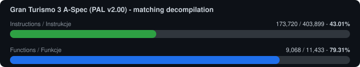
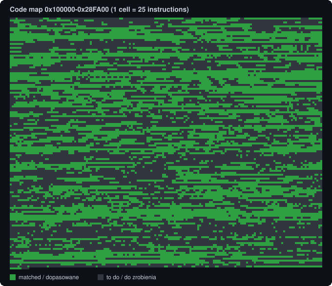
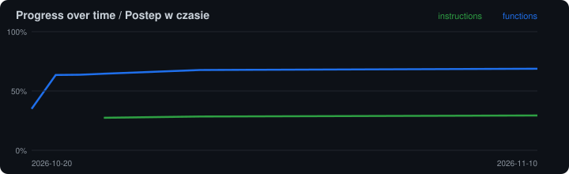

# gt3towin

<!-- BADGES -->
 -blue)  
<!-- /BADGES -->

**A matching decompilation of Gran Turismo 3 A-Spec (PlayStation 2)** — C/C++ source that compiles
byte-for-byte into the original game code. The long-term goal is a native PC port (and later PSP).

> 🇵🇱 [Wersja polska niżej](#-wersja-polska)

**This repository contains no game files or game code.** You need your own copy of the disc.

## Progress

<!-- STATS_EN -->


**162,154 / 403,899 instructions (40.15%)** and **8,843 / 11,433 functions (77.35%)** compile byte-for-byte identical to the original. *(updated 2026-11-10)*

| Function size | Functions | Done | Instructions | Progress |
|---|---:|---:|---:|---|
| 1–10 insn | 4,189 | 4,125 | 19,805 / 20,335 | `███████████████████░` 97.4% |
| 11–40 insn | 4,674 | 3,927 | 80,849 / 101,203 | `████████████████░░░░` 79.9% |
| 41–100 insn | 1,790 | 711 | 38,662 / 111,096 | `███████░░░░░░░░░░░░░` 34.8% |
| 101–300 insn | 654 | 63 | 8,163 / 104,699 | `██░░░░░░░░░░░░░░░░░░` 7.8% |
| 301–1000 insn | 121 | 13 | 6,642 / 57,449 | `██░░░░░░░░░░░░░░░░░░` 11.6% |
| >1000 insn | 5 | 4 | 8,033 / 9,117 | `██████████████████░░` 88.1% |

<details><summary>Biggest C++ classes (from RTTI)</summary>

| Class (RTTI) | Virtual methods | Done | Instructions done |
|---|---:|---:|---|
| `RaceSplitBattle` | 72 | 51 | `███░░░░░░░░░` 22% |
| `RaceLinkBattle` | 70 | 49 | `██░░░░░░░░░░` 21% |
| `RaceSolitaire` | 60 | 36 | `██░░░░░░░░░░` 19% |
| `RaceFreeRun` | 60 | 37 | `██░░░░░░░░░░` 21% |
| `RaceMachineTest` | 60 | 37 | `██░░░░░░░░░░` 20% |
| `RaceTimeTrial` | 60 | 38 | `███░░░░░░░░░` 22% |
| `RaceLicense` | 60 | 38 | `███░░░░░░░░░` 21% |
| `RaceArcade` | 56 | 40 | `███░░░░░░░░░` 23% |
| `RaceChampionship` | 56 | 40 | `███░░░░░░░░░` 23% |
| `RaceArcadeSingle` | 56 | 40 | `███░░░░░░░░░` 23% |
| `RaceFreePractice` | 56 | 40 | `███░░░░░░░░░` 23% |
| `RacePS2Base` | 56 | 39 | `██░░░░░░░░░░` 19% |

</details>





<!-- /STATS_EN -->

## Target version

PAL (Europe, Australia), v2.00, `SCES_502.94`.

- `SCES_502.94` is only a loader. The actual game code lives in `CORE.GT3`
  (6-byte header + raw deflate).
- Unpacked: a 0x114-byte header, then the code image loaded at `0x100000`, entry `0x100008`.
- `.text` 0x100000–0x28FA00, `.data` 0x28FA00–0x354B83, `.bss` 0x354C00–0x4B461C, `$gp = 0x359370`.
- About 11,400 functions. No symbols, but C++ class names survive in RTTI
  (gcc 2.x mangling, namespace `gt2k`).

## Compiler

The game is C++ built with Sony's official **ee-gcc 2.9-ee-991111**, flags `-O2 -G8`.
Every tested function matches byte-for-byte with the 2.9-ee family (990721, 991111, 991111a,
991111-01); we use **991111-01**.

Rejected candidates:
- ee-gcc 2.96: emits tail calls and has a different stack frame layout,
- SN ee-gcc 2.95.x: saves registers with `sq` (128-bit), the original uses `sd`.

Code must be compiled as **C++** — in C mode the compiler optimizes calls differently.

## How it works

1. `CORE.GT3` is unpacked and split into one assembly file per function (splat + spimdisasm).
2. Automated passes (m2c + [decomp-permuter](https://github.com/simonlindholm/decomp-permuter))
   produce candidate C, which is accepted only if it compiles to identical bytes.
3. Families of near-identical functions (vtable thunks, getters/setters, static initializers)
   are generated from templates; library code is matched against newlib / libgcc sources.
4. The remainder is decompiled by hand.

Matched functions live in `src/` (`auto/`, `perm/`, `manual/`, `xfer/`, `tf/`, `dtor/`, `lib/`).

## Getting started

```
bash tools/setup_local.sh /path/to/CORE.GT3   # packages, compiler, split
sh tools/verify_all.sh                        # re-check every matched function
```

Tools:
- `tools/funcasm.py <func>` prints the assembly of one function,
- `tools/check.py <compiler> <file.cpp> <symbol> <address>` compiles and compares with the original,
- `tools/progress.py` regenerates the statistics and charts in this README.

sha1 of `orig/core_100000.bin`: `8c69f1d3fec6bc96e6057dc0f0494051cd177ac7`

---

## 🇵🇱 Wersja polska

**Dekompilacja Gran Turismo 3 A-Spec (PS2) „bajt w bajt”** — kod C/C++, który kompiluje się
dokładnie do oryginalnego kodu gry. Cel długoterminowy: natywny port na PC, a w przyszłości na PSP.

**Repo nie zawiera żadnych plików ani kodu gry.** Potrzebujesz własnej kopii płyty.

### Postęp

<!-- STATS_PL -->
**162,154 / 403,899 instrukcji (40.15%)** i **8,843 / 11,433 funkcji (77.35%)** kompiluje się bajt w bajt identycznie z oryginałem. *(stan na 2026-11-10)*

| Rozmiar funkcji | Funkcje | Gotowe | Instrukcje | Postęp |
|---|---:|---:|---:|---|
| 1–10 instr. | 4,189 | 4,125 | 19,805 / 20,335 | `███████████████████░` 97.4% |
| 11–40 instr. | 4,674 | 3,927 | 80,849 / 101,203 | `████████████████░░░░` 79.9% |
| 41–100 instr. | 1,790 | 711 | 38,662 / 111,096 | `███████░░░░░░░░░░░░░` 34.8% |
| 101–300 instr. | 654 | 63 | 8,163 / 104,699 | `██░░░░░░░░░░░░░░░░░░` 7.8% |
| 301–1000 instr. | 121 | 13 | 6,642 / 57,449 | `██░░░░░░░░░░░░░░░░░░` 11.6% |
| >1000 instr. | 5 | 4 | 8,033 / 9,117 | `██████████████████░░` 88.1% |

<details><summary>Największe klasy C++ (z RTTI)</summary>

| Klasa (RTTI) | Metody wirtualne | Gotowe | Instrukcje gotowe |
|---|---:|---:|---|
| `RaceSplitBattle` | 72 | 51 | `███░░░░░░░░░` 22% |
| `RaceLinkBattle` | 70 | 49 | `██░░░░░░░░░░` 21% |
| `RaceSolitaire` | 60 | 36 | `██░░░░░░░░░░` 19% |
| `RaceFreeRun` | 60 | 37 | `██░░░░░░░░░░` 21% |
| `RaceMachineTest` | 60 | 37 | `██░░░░░░░░░░` 20% |
| `RaceTimeTrial` | 60 | 38 | `███░░░░░░░░░` 22% |
| `RaceLicense` | 60 | 38 | `███░░░░░░░░░` 21% |
| `RaceArcade` | 56 | 40 | `███░░░░░░░░░` 23% |
| `RaceChampionship` | 56 | 40 | `███░░░░░░░░░` 23% |
| `RaceArcadeSingle` | 56 | 40 | `███░░░░░░░░░` 23% |
| `RaceFreePractice` | 56 | 40 | `███░░░░░░░░░` 23% |
| `RacePS2Base` | 56 | 39 | `██░░░░░░░░░░` 19% |

</details>

<!-- /STATS_PL -->

### Wersja docelowa

PAL (Europe, Australia), v2.00, `SCES_502.94`. `SCES_502.94` to tylko loader, właściwy kod gry
jest w `CORE.GT3` (6 bajtów nagłówka + raw deflate). Po rozpakowaniu: nagłówek 0x114 bajtów,
obraz kodu pod `0x100000`, entry `0x100008`. Około 11 400 funkcji, bez symboli, ale z nazwami
klas C++ (RTTI, mangling gcc 2.x, przestrzeń nazw `gt2k`).

### Kompilator

Oficjalny kompilator Sony **ee-gcc 2.9-ee-991111** z flagami `-O2 -G8` (używamy 991111-01).
Odrzucone: ee-gcc 2.96 (tail-calle, inna ramka stosu) i SN ee-gcc 2.95.x (zapis rejestrów przez `sq`).
Kod trzeba kompilować jako **C++**.

### Jak to działa

1. `CORE.GT3` jest rozpakowywany i dzielony na osobny plik asemblera dla każdej funkcji.
2. Automaty (m2c + decomp-permuter) generują kandydatów w C; przyjmowane są tylko te,
   które dają identyczne bajty.
3. Rodziny podobnych funkcji (thunki vtable, gettery/settery, inicjalizatory statyczne) powstają
   z szablonów; kod bibliotek dopasowujemy do źródeł newlib / libgcc.
4. Resztę dekompilujemy ręcznie.

### Jak zacząć

```
bash tools/setup_local.sh /sciezka/do/CORE.GT3
sh tools/verify_all.sh
```

`tools/funcasm.py <func>` wypisuje asembler funkcji, `tools/check.py` kompiluje i porównuje
z oryginałem, `tools/progress.py` odświeża statystyki i wykresy w tym pliku.
